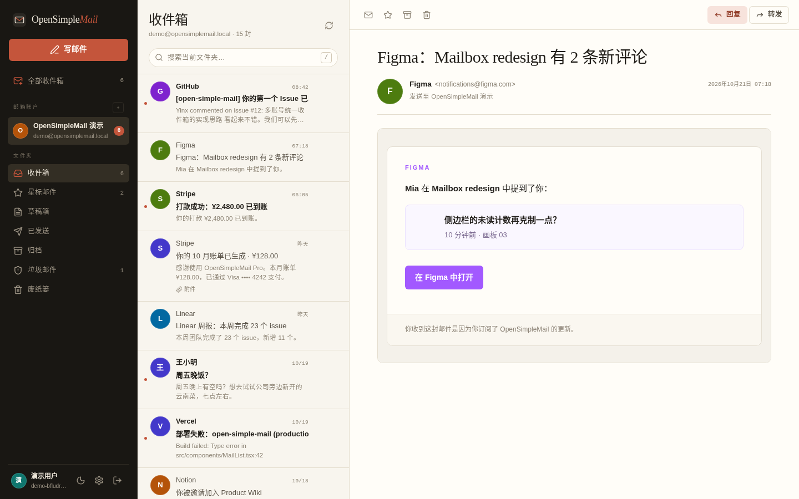
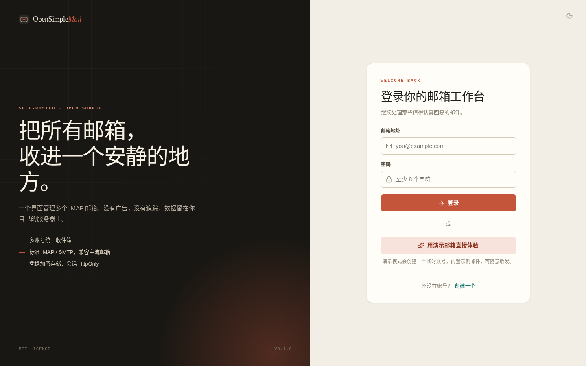
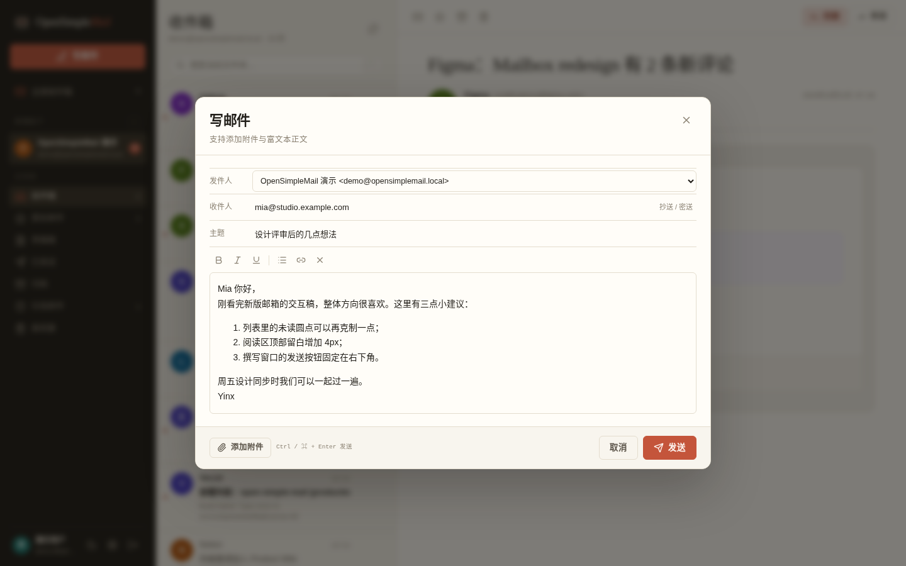
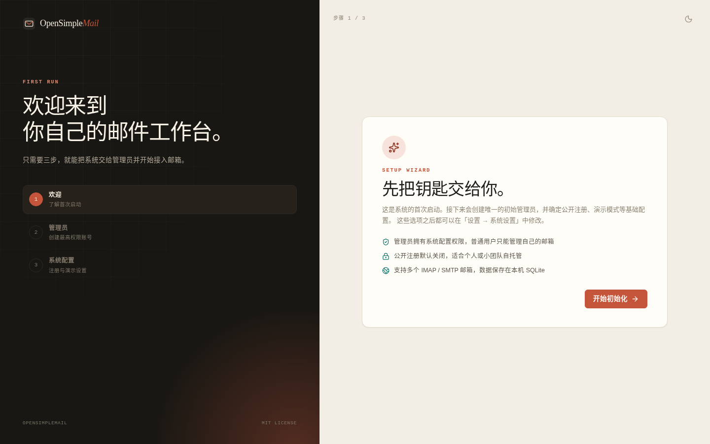
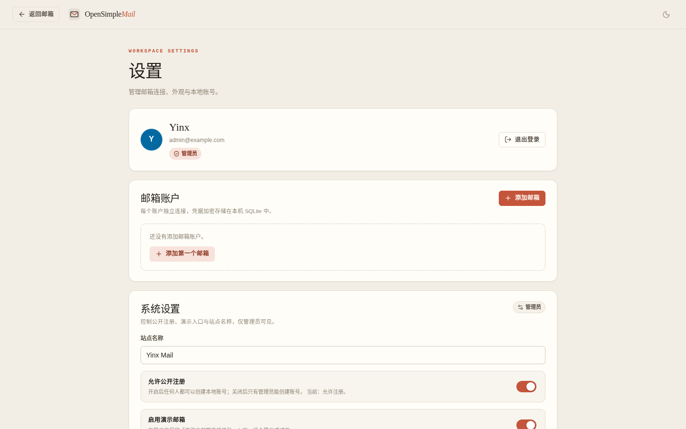
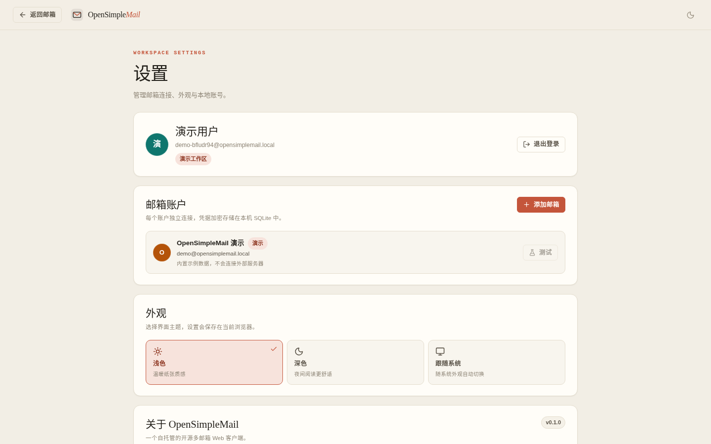
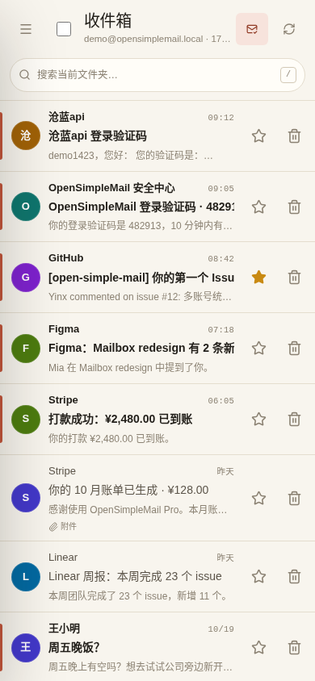
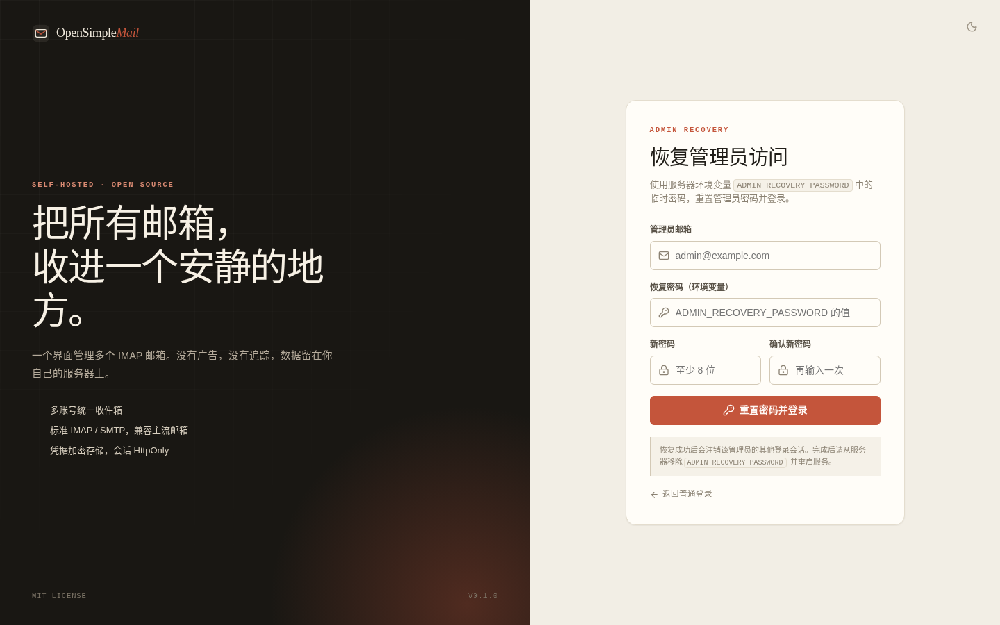
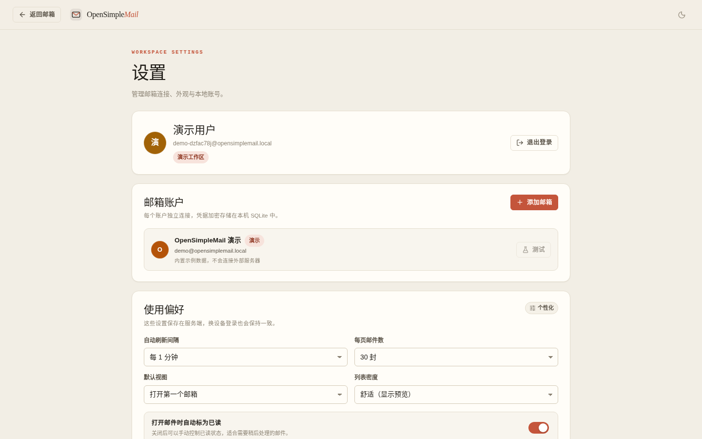

# OpenSimpleMail

> 一个安静、克制、可自托管的多邮箱 Web 客户端。

OpenSimpleMail 让你在一个界面里管理多个 IMAP / SMTP 邮箱：统一收件箱、文件夹、搜索、星标、归档、富文本撰写与附件，全都留在你自己的服务器上。没有广告，没有追踪，没有第三方邮件处理服务。

[](LICENSE)
[](https://react.dev)
[](https://nestjs.com)
[](https://biomejs.dev)



## 功能

- **首次启动向导**：第一次访问时创建管理员账号，并完成站点名称、公开注册、演示模式等初始配置。
- **管理员与注册开关**：管理员可随时开启/关闭公开注册；关闭后登录页隐藏注册入口，注册接口直接拒绝。
- **用户级使用偏好**：自动刷新间隔、每页数量、默认视图、列表密度、自动已读、远程图片策略都可以自己配置，并保存在服务端。

- **多邮箱账户**：添加任意数量的 IMAP / SMTP 邮箱，独立连接、独立文件夹与未读计数。
- **统一收件箱**：按时间合并所有账户的来信，也可以切回单个账户查看完整文件夹树。
- **完整邮件操作**：分页列表、搜索、已读 / 未读标记与一键已读、批量选择与批量已读/归档/删除、星标、删除（优先移入服务器废纸篓）。
- **阅读器三视图**：完整内容保留原始排版；简约文字去掉图片与样式，保留段落、列表和可点击链接；验证码视图从主题与正文中识别常见验证码，保留字母大小写、显示有效期并支持一键复制，识别不到时可回退到原文。选择会按浏览器记住。
- **收藏视图**：星标即收藏，跨文件夹汇总到左侧「收藏」；在收藏里可以直接阅读、取消收藏或删除，支持搜索。
- **删除有确认**：删除前显示主题、发件人和去向（废纸篓或永久删除）；可以在确认框里关闭本会话的后续确认，设置页也有对应开关。
- **撰写与回复**：富文本正文、抄送 / 密送、附件、每账户纯文本签名、收件人自动补全、回复 / 全部回复 / 转发引用，发送后自动追加到「已发送」；发送有 5 秒撤销窗口，草稿自动保存在本机，关闭后可以继续写。
- **安全默认值**：凭据 AES-256-GCM 加密、HTML 清洗、沙箱 iframe + 严格 CSP、默认拦截远程图片、CSRF 来源校验、登录限流。
- **演示模式**：零配置创建演示工作区，内置 20+ 封示例邮件，第一次打开就能体验完整界面。
- **用起来舒服**：三栏布局、明暗主题、响应式移动端；移动端支持左滑归档、右滑收藏、下拉刷新；`j/k/c/r/a//` 等键盘快捷键。
- **未读提醒**：标签页标题与 favicon 显示未读数；可在设置里开启桌面通知，页面在后台时收到新邮件会弹系统通知。

| 登录 | 撰写 |
| --- | --- |
|  |  |

| 首次启动 | 管理员设置 |
| --- | --- |
|  |  |

| 设置 | 移动端 |
| --- | --- |
|  |  |

## 技术栈

| 层 | 选择 |
| --- | --- |
| 前端 | React 19、Vite 8、TypeScript、TanStack Query、React Router、lucide-react |
| 后端 | NestJS 12（Express 适配器）、TypeScript、better-sqlite3 |
| 邮件协议 | [ImapFlow](https://imapflow.com/)（IMAP）、[Nodemailer](https://nodemailer.com/)（SMTP）、mailparser |
| 数据 | SQLite（WAL 模式），单文件、零外部服务 |
| 质量 | [Biome](https://biomejs.dev/)（lint + format + import 排序）、Vitest、GitHub Actions |

## 快速开始

### 环境要求

- Node.js **22.12+**（推荐 24，仓库自带 `.nvmrc`）
- npm 10+
- 一个支持 IMAP / SMTP 的邮箱；多数服务商需要「应用专用密码」或「客户端授权码」

### 本地开发

```bash
git clone <your-repo-url> open-simple-mail
cd open-simple-mail
npm install

cp .env.example .env
# 生成一个随机密钥，填入 .env 的 APP_SECRET
openssl rand -base64 32

npm run dev
```

- Web：<http://localhost:5174>（`.env` 的 `WEB_PORT`；Vite 会把 `/api` 代理到 `PORT`）
- API：<http://localhost:4010/api/health>（`.env` 的 `PORT`）

首次打开会进入启动向导：创建管理员账号，并设置站点名称、是否开放公开注册、是否启用演示模式。完成后即可添加邮箱；也可以先在登录页点「用演示邮箱直接体验」。

### 生产构建

```bash
npm install
npm run build

APP_SECRET="$(openssl rand -base64 32)" npm start
# 打开 http://localhost:4010（.env 的 PORT）
```

生产模式下 NestJS 会直接托管 `apps/web/dist`，只需要一个 Node 进程。

### Docker

```bash
cp .env.example .env
# 编辑 .env，至少设置 APP_SECRET
docker compose up -d --build
```

数据保存在命名卷 `open-simple-mail-data` 中（容器内 `/app/data`）。默认映射到宿主机 `4000` 端口。

## 配置

所有配置都通过环境变量提供，开发时放在项目根目录的 `.env` 中。

| 变量 | 默认值 | 说明 |
| --- | --- | --- |
| `APP_SECRET` | 开发环境内置值 | **生产必填**，至少 24 字符。用于派生凭据加密密钥和会话哈希；更换后已保存的邮箱密码将无法解密 |
| `PORT` | `4010` | API / 生产 HTTP 端口；Docker 容器内固定为 `4000` |
| `WEB_PORT` | `5174` | 本地开发时 Vite 的端口（生产与 Docker 不使用） |
| `HOST` | `0.0.0.0` | 监听地址 |
| `DATABASE_PATH` | `data/open-simple-mail.db` | SQLite 文件路径；相对路径按项目根目录解析（不随启动目录变化） |
| `WEB_ORIGIN` | `http://localhost:5174,http://127.0.0.1:5174` | 允许携带 Cookie 调用 API 的浏览器来源，逗号分隔 |
| `DEMO_ENABLED` | `true` | 首次初始化时的演示模式默认值；初始化后以「设置 → 系统设置」中的值为准 |
| `MAX_ATTACHMENT_MB` | `25` | 单封邮件附件总大小上限（MB） |
| `SESSION_DAYS` | `30` | 登录会话有效期（天） |
| `COOKIE_SECURE` | `false` | 通过 HTTPS 部署时设为 `true` |
| `TRUST_PROXY` | `0` | 反向代理层数；放在 Nginx/Caddy 后设为 `1`，否则客户端可伪造 `X-Forwarded-For` |
| `ADMIN_RECOVERY_PASSWORD` | 空 | 可选的管理员应急恢复密码，至少 12 字符。设置后登录页出现「忘记管理员密码？」；用完请删除并重启 |
| `WEB_DIST` | 自动探测 | 自定义前端构建产物目录 |

## 首次启动与权限

第一次启动时数据库是空的，访问任意页面都会跳转到 `/setup`：

1. **欢迎**：说明系统会创建什么、默认策略是什么。
2. **管理员账号**：设置昵称、登录邮箱和密码。该账号拥有系统配置权限。
3. **系统设置**：站点名称、是否允许公开注册、是否启用演示邮箱。完成后自动登录。

之后管理员可以在「设置 → 系统设置」中随时修改：

- **允许公开注册**：关闭后 `/register` 页面显示「注册已关闭」，`POST /api/auth/register` 返回 403，登录页隐藏注册链接。
- **启用演示邮箱**：控制登录页是否出现「用演示邮箱直接体验」。
- **站点名称**：显示在登录页、页面标题和系统设置中。

未初始化时，除健康检查、公开配置和 `/api/setup` 之外的 API 都会返回 `412 Precondition Failed`。从旧版本升级的数据库会自动把最早创建的用户提升为管理员，并保留原有的开放注册策略。

### 忘记管理员密码怎么办

系统不保存明文密码，也没有默认后门。管理员忘记密码时，可以用环境变量做一次临时恢复：

1. 在 `.env`（或 Docker Compose 的环境变量）中临时设置：

   ```bash
   ADMIN_RECOVERY_PASSWORD="$(openssl rand -base64 24)"
   ```

2. 重启服务。登录页会出现「忘记管理员密码？」入口。
3. 输入管理员邮箱、上面的恢复密码，并设置一个新密码。提交后会：
   - 校验恢复密码（常量时间比较）
   - 更新管理员密码
   - **注销该管理员的所有旧会话**
   - 直接登录并进入工作台
4. 登录成功后，立即从 `.env` 删除 `ADMIN_RECOVERY_PASSWORD` 并再次重启，避免长期保留后门。

恢复入口只对 `is_admin = 1` 的账号生效，非管理员、未知邮箱和错误恢复密码都会返回同一条错误信息；接口有独立的速率限制。恢复密码至少 12 字符，过短会导致服务启动失败。



### 使用偏好

「设置 → 使用偏好」中的选项按用户保存在 SQLite 中，换设备登录也会保留：

| 选项 | 说明 |
| --- | --- |
| 自动刷新间隔 | 关闭 / 15 秒 / 30 秒 / 1 分钟 / 5 分钟 / 10 分钟；同时作用于邮件列表、统一收件箱和文件夹未读数 |
| 每页邮件数 | 20 / 30 / 50 / 100 封 |
| 默认视图 | 打开第一个邮箱，或直接进入全部收件箱 |
| 列表密度 | 舒适（显示两行预览）/ 紧凑（隐藏预览，一屏更多邮件） |
| 打开邮件自动标为已读 | 关闭后可以手动控制已读状态 |
| 默认显示远程图片 | 开启后不再逐封拦截远程图片；可能被发件人用于阅读追踪 |

自动刷新关闭后，窗口重新聚焦和右上角刷新按钮仍然有效。列表顶部会显示当前的刷新节奏。



## 接入邮箱

添加账户时可以选择预设，也可以完全手填：

| 服务商 | IMAP | SMTP | 备注 |
| --- | --- | --- | --- |
| Gmail | `imap.gmail.com:993` SSL | `smtp.gmail.com:465` SSL | 需开启两步验证并使用应用专用密码 |
| Outlook / Microsoft 365 | `outlook.office365.com:993` SSL | `smtp.office365.com:587` STARTTLS | 租户需允许 IMAP/SMTP |
| QQ 邮箱 | `imap.qq.com:993` SSL | `smtp.qq.com:465` SSL | 在设置中开启 IMAP/SMTP，使用授权码 |
| 网易 163 / 126 | `imap.163.com:993` SSL | `smtp.163.com:465` SSL | 使用客户端授权密码 |
| iCloud | `imap.mail.me.com:993` SSL | `smtp.mail.me.com:587` STARTTLS | 使用 App 专用密码 |
| Yahoo | `imap.mail.yahoo.com:993` SSL | `smtp.mail.yahoo.com:465` SSL | 使用第三方应用密码 |
| 自建 / 其他 | 按服务商文档填写 | 按服务商文档填写 | 支持任意标准 IMAP/SMTP |

> 本项目使用标准协议，不依赖 Gmail / Microsoft 的私有 API，因此也不需要 OAuth 应用审核；代价是必须使用应用专用密码。

## 安全模型

OpenSimpleMail 面向**单租户自托管**场景：服务器主人就是所有邮箱账户的使用者。

- 首次启动必须通过 `/setup` 创建管理员；未初始化时业务 API 返回 412，注册与演示入口也被禁用。
- 管理员可以关闭公开注册，服务端会对注册接口强制校验，而不是只隐藏前端入口。
- 管理员恢复依赖可选的 `ADMIN_RECOVERY_PASSWORD` 环境变量；恢复成功会轮换密码并注销该账号的全部旧会话，用完应立即移除变量。
- 本地账号密码使用 `scrypt` 加盐哈希；会话令牌只以 SHA-256 摘要形式落库，Cookie 为 `HttpOnly` + `SameSite=Lax`。
- 邮箱密码使用 AES-256-GCM 加密，密钥由 `APP_SECRET` 派生；API 永远不会回传密码。
- 邮件 HTML 在服务端用 sanitize-html 清洗，在客户端放进 `sandbox` iframe 渲染；iframe 内 CSP 为 `default-src 'none'`，默认阻止远程图片，点击「显示图片」后才允许。
- 验证码识别完全在浏览器内完成，正文不会因此发送到第三方服务。
- 所有非 GET 请求校验浏览器 `Origin`；登录、注册、演示入口有速率限制。
- 附件下载强制 `Content-Disposition: attachment`，并设置 `X-Content-Type-Options: nosniff`。

部署时请务必：

1. 设置强随机 `APP_SECRET`，不要提交 `.env`。
2. 放在 HTTPS 反向代理之后，并设置 `COOKIE_SECURE=true`。
3. 定期备份 `data/` 目录；`APP_SECRET` 丢失意味着已保存的邮箱凭据无法恢复。
4. 不要把实例开放给不受信任的多用户使用：用户可以填写任意 IMAP 主机，这天然具有 SSRF 面。

更多细节见 [SECURITY.md](SECURITY.md)。

## 键盘快捷键

| 按键 | 动作 |
| --- | --- |
| `c` | 写邮件 |
| `/` | 聚焦搜索 |
| `j` / `k` | 下一封 / 上一封 |
| `r` | 回复当前邮件 |
| `a` | 全部回复当前邮件 |
| `f` | 转发当前邮件 |
| `s` | 收藏 / 取消收藏 |
| `u` | 标为已读 / 未读 |
| `e` | 归档当前邮件 |
| `#` | 删除当前邮件 |
| `x` | 选择 / 取消选择当前邮件 |
| `g` `i` | 回到收件箱 |
| `?` | 打开 / 关闭快捷键帮助 |
| `Esc` | 清空选择 / 关闭阅读区 / 弹窗 |
| `Ctrl` / `⌘` + `Enter` | 在撰写窗口中发送 |

## 项目结构

```text
open-simple-mail/
├── apps/
│   ├── server/                 # NestJS API
│   │   ├── src/
│   │   │   ├── auth/           # 注册、登录、会话、Guard
│   │   │   ├── accounts/       # 邮箱账户 CRUD 与连接测试
│   │   │   ├── mail/           # IMAP 连接池、SMTP、清洗、REST 控制器
│   │   │   ├── demo/           # 内置演示邮箱（SQLite 持久化）
│   │   │   └── core/           # 配置、SQLite、加密
│   │   └── test/               # 黑盒 HTTP 端到端测试
│   └── web/                    # React + Vite 前端
│       └── src/
│           ├── components/     # 三栏布局、列表、阅读器、撰写窗
│           ├── pages/          # 登录、注册、邮箱、设置
│           └── lib/            # API 客户端、认证、主题、Toast
├── packages/shared/            # 前后端共享的 API 类型
├── docs/screenshots/
├── biome.json
├── Dockerfile
└── docker-compose.yml
```

## 常用脚本

| 命令 | 作用 |
| --- | --- |
| `npm run dev` | 同时启动 NestJS（watch）与 Vite |
| `npm run build` | 构建 shared、web、server |
| `npm start` | 启动生产服务器（需先 build） |
| `npm run lint` | Biome 检查（含格式与 import 排序） |
| `npm run lint:fix` | Biome 自动修复 |
| `npm run typecheck` | 全仓库 TypeScript 检查 |
| `npm test` | 服务端单元测试 + 黑盒端到端测试 |
| `npm run check` | lint → typecheck → test → build |

> 服务端使用 `emitDecoratorMetadata`，因此**构造函数注入的 provider 与 DTO 类必须使用值导入**。`biome.json` 已为 `apps/server/**` 关闭 `useImportType`，避免自动修复破坏 NestJS 依赖注入。

## 测试

```bash
npm test
```

测试包含：

- 加密与密码哈希（scrypt、AES-GCM、篡改检测）
- 邮件 HTML 清洗（脚本、事件属性、`javascript:`、iframe、cid 图片）
- 真实启动 NestJS 进程的 HTTP 端到端测试：注册 / 登录 / 登出 / CSRF / 演示邮箱 / 发送附件 / 移动删除 / 账户 CRUD
- 开发过程中还用 GreenMail 容器验证了真实 IMAP/SMTP 链路：连接测试、SMTP 发信、IMAP 收件、搜索、附件下载、标记与删除

## 路线图

- [ ] OAuth 2.0（Gmail、Microsoft Graph）作为应用密码的替代方案
- [ ] 本地邮件缓存与离线阅读
- [ ] 附件流式上传 / 下载，避免整封邮件驻留内存
- [ ] 草稿箱与自动保存
- [ ] 多管理员、用户管理与操作审计
- [ ] 修改本地账号密码 / 两步验证
- [ ] 多语言界面（i18n）
- [ ] PWA 与桌面通知

## 贡献

欢迎 Issue、设计建议和 Pull Request。提交前请先阅读 [CONTRIBUTING.md](CONTRIBUTING.md)，并确保 `npm run check` 通过。

## 许可证

[MIT](LICENSE) © OpenSimpleMail contributors

---

### English

OpenSimpleMail is a self-hosted, open-source webmail client for managing multiple IMAP/SMTP mailboxes. It ships a React 19 + Vite frontend, a NestJS 12 API, SQLite storage, encrypted credentials, sanitized HTML rendering in a sandboxed iframe, a built-in demo workspace, Biome for code quality, Vitest end-to-end tests, Docker and GitHub Actions.

See [README.en.md](README.en.md) for the English quick start.
